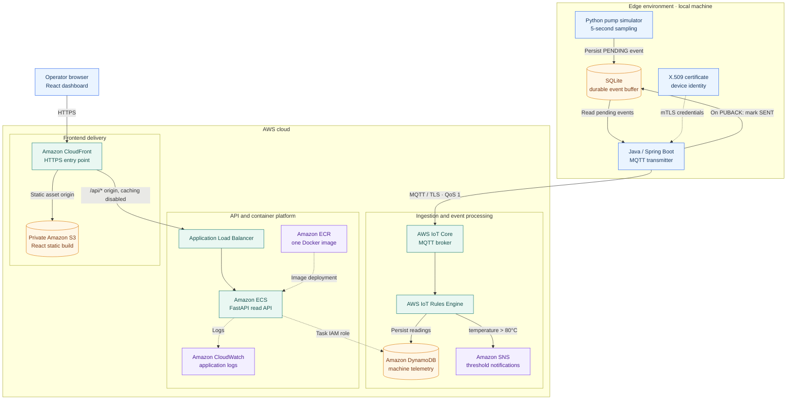
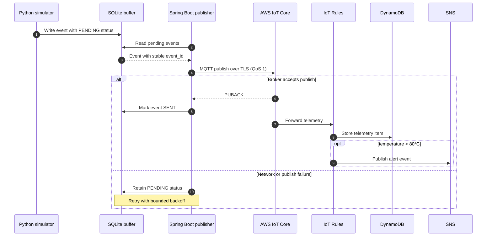

<div align="center">

# Industrial IoT Monitoring Platform

**Edge-to-cloud reference architecture for reliable industrial telemetry ingestion, event-driven alerting, and cloud-native monitoring on AWS.**

[](https://aws.amazon.com/)


**[Architecture](#system-architecture) · [Design decisions](#key-architecture-decisions) · [Data model & API](#data-model-and-api-contract) · [Deployment](#deployment-architecture) · [Validation](#validation-strategy)**

</div>

---

## Overview

This project defines an end-to-end Industrial IoT monitoring solution that connects a **simulated industrial pump** to an AWS-based telemetry platform. It brings together edge persistence, secure MQTT messaging, serverless data ingestion, a containerized read API, and a React monitoring dashboard.

The architecture deliberately separates **device-to-cloud ingestion** from **dashboard-to-API access**, allowing each path to scale, fail, and evolve independently.

> **Project status:** This README presents the reference design and planned implementation. It does not imply that every component has been deployed or that performance, resilience, or cost targets have been measured.

### Architectural scope

| Concern | Proposed approach |
|---|---|
| Edge telemetry | Python simulator produces temperature, pressure, and vibration readings every 5 seconds |
| Disconnected operation | SQLite-backed store-and-forward buffer with retry tracking |
| Secure ingestion | Java / Spring Boot publisher using MQTT QoS 1 and X.509 authentication |
| Event processing | AWS IoT Rules route data to DynamoDB and threshold alerts to SNS |
| Data access | Read-only FastAPI application using IAM-based DynamoDB access |
| Presentation | React / Vite dashboard distributed by private S3 and CloudFront |
| Compute evaluation | Same API container image deployed to ECS on EC2 and ECS on Fargate |

## System Architecture



**Traffic boundaries:** Device telemetry reaches **AWS IoT Core directly**; it does not traverse the application load balancer. The browser accesses frontend assets and the `/api/*` service through **CloudFront**. ECS on EC2 and ECS on Fargate are **alternative hosting configurations** for the same API—not separate application tiers.

### Telemetry delivery sequence



## Key Architecture Decisions

| Decision | Rationale / trade-off |
|---|---|
| **Store before publish** | Local SQLite buffering protects committed readings against temporary loss of internet access or publisher restarts. It introduces local state and requires recovery handling. |
| **MQTT QoS 1 with stable event IDs** | Provides broker-level acknowledgment and at-least-once delivery. A `PUBACK` does **not** confirm successful DynamoDB persistence; duplicate publishes remain possible. |
| **Time-ordered DynamoDB keys** | `machine_id` as partition key and `reading_id` (`timestamp#event_id`) as sort key support per-machine history queries and stable identities on replay. |
| **IoT Rules for initial event processing** | Direct storage and simple temperature thresholds avoid introducing a custom ingestion service. Advanced deduplication and alert suppression are deliberately outside the initial scope. |
| **Separate ingest and query paths** | Decouples equipment messaging from user traffic, reducing API involvement in telemetry delivery and allowing independent operational control. |
| **One API image, two ECS compute models** | Preserves application behavior while comparing infrastructure ownership, deployment operations, and cost characteristics of EC2-backed and Fargate-backed ECS. |
| **CloudFront with dual origins** | Private S3 delivers static React assets; an ALB origin handles dynamic `/api/*` traffic with response caching disabled. |

### Reliability boundaries

The edge publisher tracks `PENDING` and `SENT` states, publish attempts, and timestamps. Connection failures leave events available for replay. **Exactly-once end-to-end processing is not guaranteed:** QoS 1 permits duplicates, IoT Rule actions can fail after broker acceptance, and threshold events may produce repeated notifications. Operational monitoring and stable data keys mitigate—but do not eliminate—those risks.

## Data Model and API Contract

A telemetry event has a stable identifier across retries and a time-sortable reading key:

```json
{
  "machine_id": "PUMP-001",
  "event_id": "evt-001",
  "reading_id": "2026-10-19T10:00:00Z#evt-001",
  "timestamp": "2026-10-19T10:00:00Z",
  "temperature": 82.5,
  "pressure": 145.2,
  "vibration": 6.1
}
```

**Conventions:** UTC timestamps; illustrative units °C, bar, and mm/s. MQTT topic: `factory/pumps/PUMP-001/telemetry`. The initial alert condition is `temperature > 80°C`.

| Method | Route | Purpose |
|---|---|---|
| `GET` | `/health` | Service health check |
| `GET` | `/api/machines` | Available machine identifiers |
| `GET` | `/api/latest?machine_id=PUMP-001` | Latest telemetry sample |
| `GET` | `/api/history?machine_id=PUMP-001` | Chronological sample history |
| `GET` | `/api/alerts?machine_id=PUMP-001` | Readings exceeding the alert threshold |

The read API uses DynamoDB queries rather than placing database access in the frontend. Alerts in the first iteration may be derived from stored readings instead of maintaining a separate alert data store.

## Deployment Architecture

The **same versioned FastAPI Docker image** is published to Amazon ECR and used in two ECS deployment configurations.

| Dimension | ECS on EC2 | ECS on Fargate |
|---|---|---|
| Application source and image | Identical | Identical |
| Compute capacity | Self-managed EC2 instances | AWS-managed task infrastructure |
| Host lifecycle and patching | Platform/operator responsibility | Managed by AWS |
| Scaling considerations | Cluster capacity plus service task count | Task/service scaling without host management |
| Operational emphasis | Capacity placement, host maintenance, utilization | Task sizing, startup, networking, per-task billing |
| ALB integration | ECS service target group | ECS service target group |

Both options require appropriate task definitions, networking, health checks, IAM task roles, and CloudWatch logging. **No deployment benchmark or cost advantage is claimed without measured results.**

### Security and operational design

- **Device identity:** AWS IoT Thing registration, X.509 certificate authentication, TLS, and topic-scoped IoT policies.
- **Least privilege:** IoT Rules permissions for target services; ECS task roles for DynamoDB read access. No embedded AWS access keys.
- **Web delivery:** Private S3 origin behind CloudFront; HTTPS for viewers and the ALB origin, with a valid origin certificate and suitable ingress restrictions.
- **Secrets management:** Keep certificates/private keys, credentials, `.env` files, and SQLite databases outside version control.
- **Observability:** CloudWatch API logs, ECS task health, IoT Rule failures, and edge retry/backlog state are priority diagnostic signals.
- **Scope:** Synthetic telemetry only. No device commands or production industrial-control integration are part of this reference design.

## Validation Strategy

The architecture is intended to be validated through observable, end-to-end scenarios rather than assumed guarantees.

| Scenario | Evidence to capture |
|---|---|
| Normal ingestion | Pump sample visible in IoT Core and stored in DynamoDB |
| Disconnected edge | Buffered events remain locally durable, then replay after reconnect |
| Threshold breach | Temperature above 80°C results in an SNS email notification |
| API and dashboard | Recent stored telemetry returned through the ALB and displayed in React |
| Container portability | Identical ECR image responds successfully on ECS EC2 and Fargate |
| Runtime recovery | Task restart, health-check recovery, and logs inspected in CloudWatch |

> Validation scenarios are **acceptance criteria**, not assertions of completed tests. Screenshots, run logs, and measured results should be added only when obtained.

---

<div align="center">

<sub>Industrial IoT Monitoring Platform · Edge-to-cloud architecture · AWS IoT · Containerized APIs · Resilient telemetry</sub>

</div>
